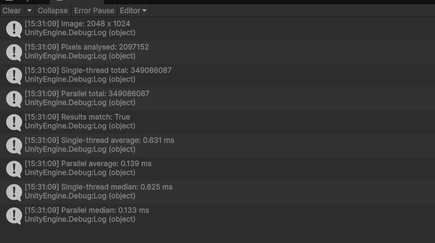
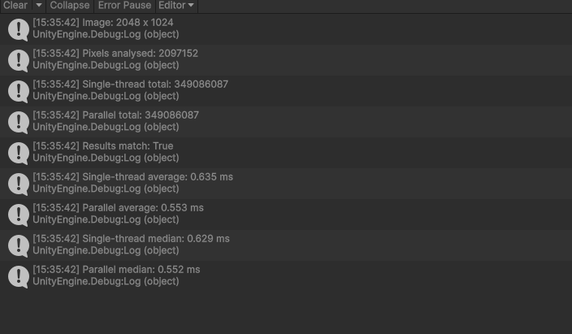

# Parallel Computation System task 


## Introduction (50 words)

The purpose of this project was to analyse the performance of parallel processing in Unity by implementing a system which calculates the total red-channel values of an image. I looked into parallel processing to understand how games can carry out larger calculations more efficiently when spread across multiple CPU threads.  


## How Were Multithreading or Jobs Implemented? (134 words)

In order to implement multithreading, I used Unity's job system to distribute  image processing across many CPU threads. I chose a bright colourful image that was 2048 x 1024 and imported it into Unity. I used `GetPixels32()` to get the image pixel data and stored it in a `NativeArray` so all the jobs could access them safely. 

```C#
[ReadOnly] public NativeArray<Color32> Pixels;
[WriteOnly] public NativeArray<long> PartialSums;
```
Using `IJobParallelFor`, I divided the image into 512 chunks of 4,096 pixels. Each job was responsible for calculating the sum of red-channel values within its assigned chunk and storing it separately. Once all of the jobs were finished, the sums were all added together to produce the final total.

```C# 
 public void Execute(int index)
    {
        int start = index * PixelsPerChunk;
        int end = start + PixelsPerChunk;

        if (end > Pixels.Length)
            end = Pixels.Length;

        long sum = 0;

        for (int i = start; i < end; i++)
        {
            sum += Pixels[i].r;
        }

        PartialSums[index] = sum;
    }
```

I also implemented a single-threaded version using a standard C# loop. This allowed me to compare the performance of both approaches and verify that they produced identical results. 

```C# 
  private static long CalculateSingle(Color32[] pixels)
    {
        long total = 0;

        for (int i = 0; i < pixels.Length; i++)
        {
            total += pixels[i].r;
        }

        return total;
    }
```

## What Tools, Frameworks or APIs Were Used? (104 words)

The project was made in Unity using C#. I implemented Unity's job system to distribute image processing calculations across multiple CPU threads. I then used the burst compiler to optimise the performance of these jobs. 

I used `NativeArray` to store the image pixel data so it could be safely accessed by the jobs. The `IJobParallelFor` interface allowed the image to be processed in separate chunks.

To measure performance, I used the `System.Diagnostics.Stopwatch API` to record performance times in milliseconds. This allowed me to compare the performance of single-threaded processing, parallel jobs and Burst optimisation and see which one had the best result. 


## 4. What Benchmarking or Telemetry Data Was Collected? (165 words)

To analyse the performance of the system, I implemented benchmarks which compared three different processing methods. Each method was tested using the same image, with five warm up runs to make sure it was running smoothly followed by twenty executions to provide an average and a median for each method. This allowed me to compare the overall performance with more accurate data. I also checked that the total red-channel values matched between each method to ensure the calculations produced consistent results.

I also compared parallel processing with Burst compilation enabled and disabled to investigate its impact on performance. 

Parallel jobs with Burst ended up being 4.5x times faster than single-threaded processing. Parallel jobs with Burst was also 4x times faster than parallel jobs without Burst. Compared with single-threaded processing, parallel jobs with Burst reduced performance time by 78%. These results suggest that Burst compilation played an important role in improving the overall performance of the system.

**Results**
| Method | Average | Median |
|---|---:|---:|
| Single-threaded C# | 0.631 ms | 0.625 ms |
| Parallel Jobs without Burst | 0.553 ms | 0.552 ms |
| Parallel Jobs with Burst | 0.139 ms | 0.133 ms |

All calculations returned **349,086,087**.



**Figure 1**. Results with Burst compilation.



**Figure 2.** Results without Burst compilation. 

## How Could the Performance Results Inform Optimisation? (60 words)

The results suggest that combing parallel processing with Burst compilation can significantly improve performance when processing large amounts of data. Within games development this can be useful for managing multiple objects or processing terrain data. However, further testing with different image sizes and chunk sizes could help identify the most efficient approach and whether smaller workloads benefit from parallel processing.


## Declaration and sources 
- Chat GPT was used to teach and implement code 

Getting Started with the Job System in Unity 2019 (2019) Directed by Code Monkey. At: https://www.youtube.com/watch?v=C56bbgtPr_w (Accessed  17/11/2026).

Technologies, U. (s.d.) Unity - Manual: Parallel jobs. At: https://docs.unity3d.com/6000.1/Documentation/Manual/job-system-parallel-for-jobs.html (Accessed  17/11/2026).

Write multithreaded code with the job system • Distribute work across threads • 6000.6 • Unity Editor (s.d.) At: https://docs.unity.com/en-us/engine/6000.6/manual/scripting/programming-distribute-work-threads/job-system (Accessed  17/11/2026).

Rainbow colors Wallpaper 4K (s.d.) At: https://4kwallpapers.com/abstract/rainbow-colors-colorful-background-multi-color-pattern-5k-8k-5679.html (Accessed  17/11/2026). - image used 
